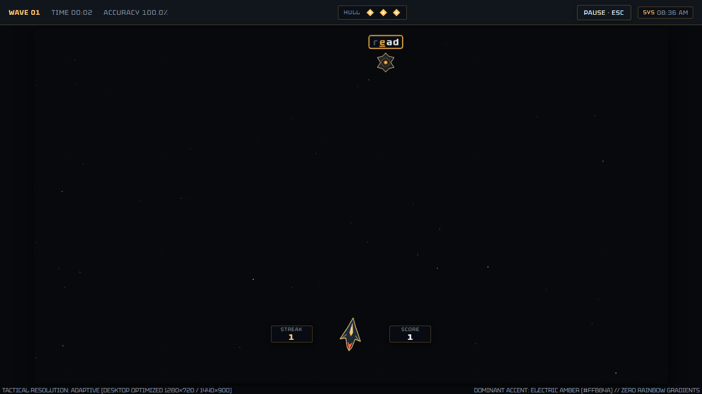
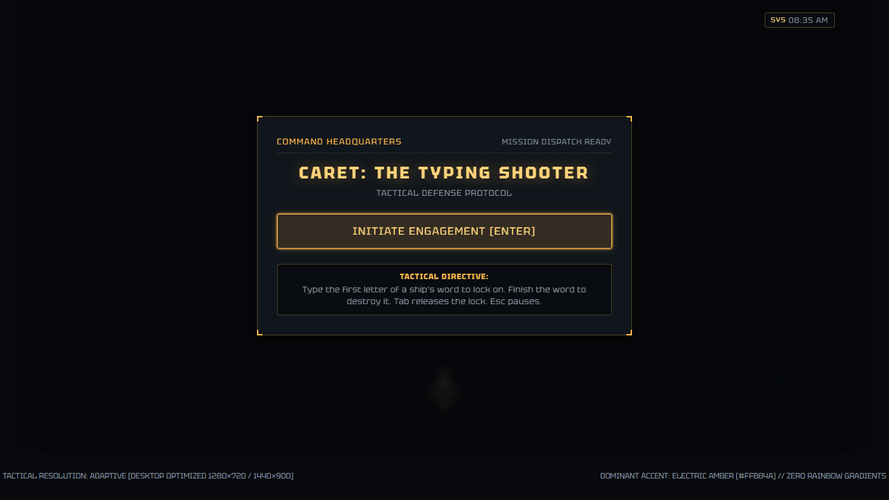
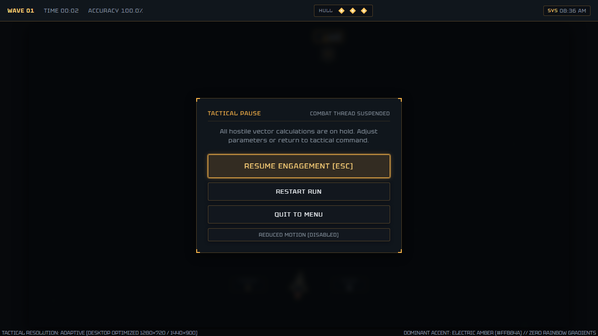
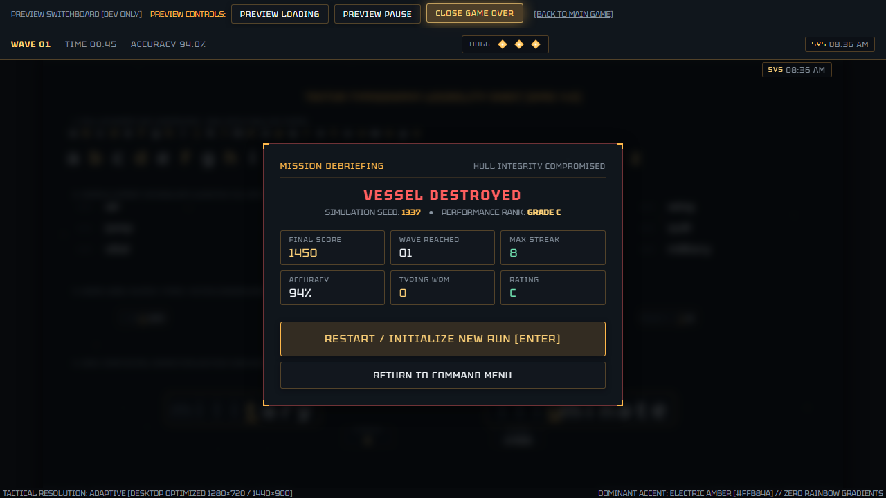
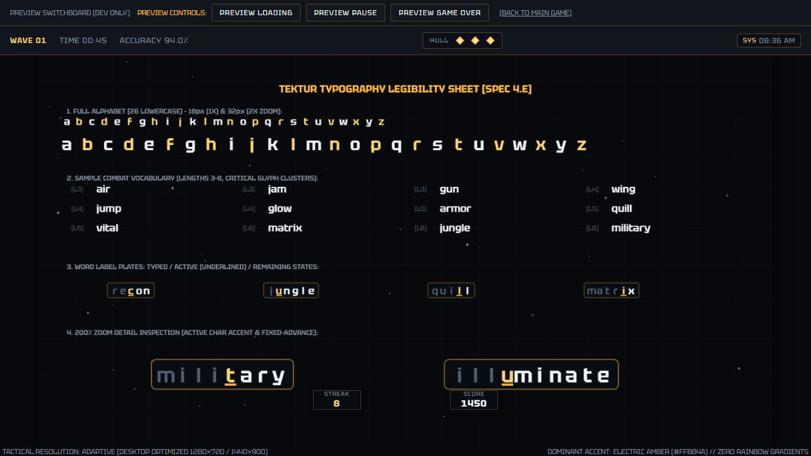

# Futuristic Typing Shooter

A minimalist dark sci-fi typing shooter built with **React**, **TypeScript**, and **Phaser 3**.

---

## Visual Direction & Aesthetic Philosophy

* **Theme:** Tactical military HUD console. Minimalist dark sci-fi, not an arcade carnival.
* **Palette:**
  * Background: Deep charcoal / near black (`#07090c`, `#0d1218`).
  * Dominant Accent: Electric Amber (`#ffb84a`).
  * Text: White (`#f3f7fa`) for high-priority telemetry; Muted Gray (`#8995a1`) for context.
  * Surfaces: Dark translucent glass (`rgba(18, 24, 31, 0.88)`) with subtle amber borders.
* **Typography:** Tektur monospace font for crisp, fixed-width combat legibility, word labels, and telemetry.

---

## Visual Showcase

### Active Combat & Dynamic Aim Tracking

*Real-time engagement demonstrating active target typing lock, spacecraft dynamic angular aim tracking, aerodynamic golden laser bolts, HUD telemetry top-strip, and wing-anchored streak/score boxes.*

---

### Command Headquarters & Debriefing Modals
| Tactical Command Menu | Tactical Pause Screen |
| :---: | :---: |
|  |  |
| *Mission briefing, engagement directives, and launch controls.* | *Combat thread suspension with restart and motion accessibility controls.* |

| Mission Debriefing (Game Over) | Visual Preview Switchboard |
| :---: | :---: |
|  |  |
| *Post-combat telemetry: accuracy, WPM, streak, and performance rating.* | *Developer switchboard with typography validation sheets (?preview=1).* |

---

## Directory Architecture

```text
PROJECT 11 - TYPING SHOOTING GAME/
├── docs/
│   ├── screenshots/        # High-resolution UI & gameplay visual captures
│   └── source-assets/      # Source asset packages & provenance archives
├── public/
│   └── assets/
│       ├── audio/          # Active audio cues (click, laser, hit, destroy, wrong-input, wave-complete)
│       ├── fonts/          # Tactical display fonts (Kenney Future, Kenney Future Narrow)
│       └── vfx/            # Original SVG entities (player-ship, drone, projectile-reticle)
├── src/
│   ├── app/
│   │   ├── App.tsx         # Root tactical console shell
│   │   ├── routes.ts       # Route / state definitions
│   │   └── app.css         # Design tokens & tactical theme styles
│   ├── game/
│   │   ├── config.ts       # Phaser GameConfig factory (1280x720 Scale.FIT)
│   │   ├── core/           # Game simulation interfaces
│   │   ├── input/          # Typing dispatcher contracts
│   │   ├── rendering/      # Procedural VFX helper module
│   │   └── scenes/
│   │       ├── BootScene.ts          # Asset preloader
│   │       ├── GameScene.ts          # Main gameplay scene
│   │       └── VisualPreviewScene.ts # Dev preview scene (?preview=1)
│   ├── ui/
│   │   ├── components/
│   │   │   ├── TacticalFrame.tsx       # Translucent glass HUD panel
│   │   │   ├── TacticalButton.tsx      # Sci-fi button with keyboard focus ring
│   │   │   ├── MetricCard.tsx          # Telemetry stat display
│   │   │   ├── ActiveTargetReadout.tsx # Target lock 3-tier word display
│   │   │   ├── HUDOverlay.tsx          # Tactical HUD overlay
│   │   │   ├── LoadingOverlay.tsx      # Fullscreen loading state
│   │   │   ├── PauseModal.tsx          # Tactical pause modal
│   │   │   └── GameOverModal.tsx       # Debriefing summary modal
│   │   └── PhaserContainer.tsx         # React ref wrapper with clean teardown
│   ├── shared/
│   │   ├── config/
│   │   │   └── defaultConfig.ts # Centralized desktop defaults & difficulty presets
│   │   ├── domain/              # Pure domain contracts (renderer & UI agnostic)
│   │   ├── theme.ts             # Color palette & visual constants
│   │   └── types.ts             # Shared telemetry types
│   ├── assets/
│   │   └── index.ts        # Asset key constants
│   ├── tests/
│   │   ├── setup.ts                # Vitest setup
│   │   ├── App.test.tsx            # Console shell tests
│   │   ├── HUDComponents.test.tsx  # UI primitives tests
│   │   ├── PhaserContainer.test.tsx # StrictMode lifecycle tests
│   │   └── domainConfig.test.ts    # Domain configuration tests
│   ├── main.tsx            # React application entry
│   └── vite-env.d.ts       # Vite client types
├── e2e/
│   └── app.spec.ts         # Playwright smoke, lifecycle, and contrast tests
├── eslint.config.js        # Strict ESLint configuration
├── .prettierrc             # Code formatting rules
├── tsconfig.json           # Strict TypeScript configuration
├── vite.config.ts          # Vite build & dev config
├── vitest.config.ts        # Vitest test runner config
├── playwright.config.ts    # Playwright browser test config
└── package.json            # Scripts & scoped dependencies
```

---

## Getting Started

### Installation
```bash
npm install
```

### Development Server
```bash
npm run dev
```
Starts the Vite development server at `http://localhost:3000`.
To view the visual preview switchboard, navigate to: `http://localhost:3000/?preview=1`.

### Production Build
```bash
npm run build
```
Executes TypeScript type checking (`tsc -b`) and bundles the application with Vite.

### Testing
```bash
npm run test      # Executes Vitest unit & component tests
npm run test:e2e  # Executes Playwright browser tests
```

### Code Quality
```bash
npm run lint          # Run ESLint across TypeScript codebase
npm run format        # Format code with Prettier
npm run format:check  # Check formatting compliance
```
