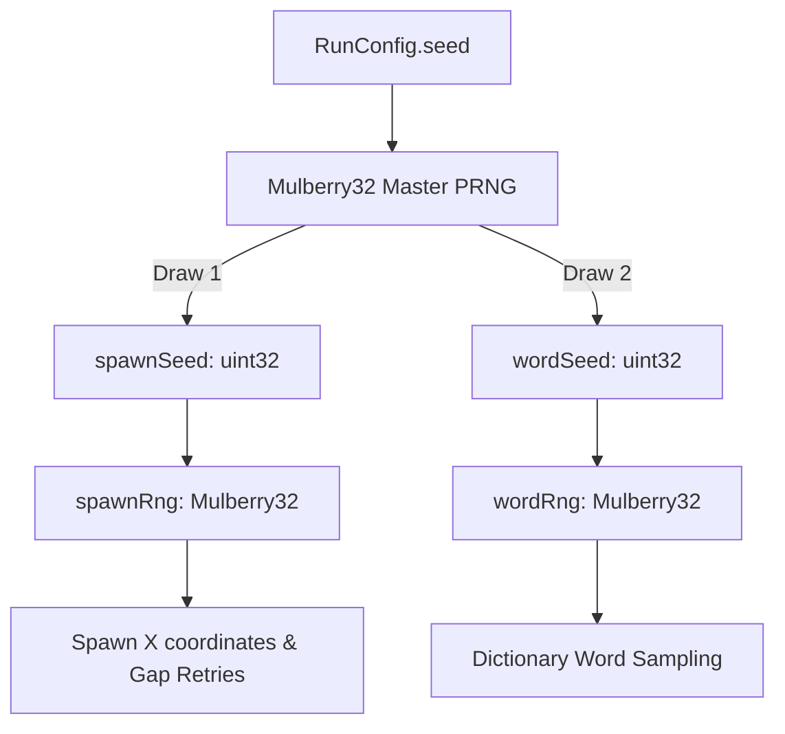

# Caret: The Typing Shooter — Deterministic Game Simulation Architecture

## 1. Overview & Architectural Boundaries
The simulation engine (`src/game/core/simulation.ts`) is a framework-independent, headless, deterministic state machine. It contains zero dependencies on Phaser, React, DOM APIs, or browser globals (`window`, `document`, `Math.random()`, `Date.now()`, `performance.now()`).

All time progression is quantized into discrete 60Hz simulation ticks (`tickRate = 60`), and all random operations are driven by a deterministic Mulberry32 PRNG.

---

## 2. Typing & Combat Rules (The 13 Canonical Rules)

1. **Command Lifecycle:** Commands are strictly ignored unless simulation status is `'running'`. After `'game-over'`, `tick()` and `handleCommand()` perform no operations.
2. **Health Per Letter:** At spawn, `maxHealth = health = word.length`. Each correct character keystroke inflicts exactly 1 damage. The word completes and the enemy is destroyed precisely when health reaches 0.
3. **Target Acquisition & Tie-Breaking:** When no target is locked, typed character is matched against `remainingWord[0]` across all alive enemies. Tie-break: resolved by smallest squared Euclidean distance to player, then by lowest numeric entity ID (e.g. `e1` before `e2`, `e9` before `e10`). A match locks the target and emits `TARGET_LOCKED` before processing the hit.
4. **Unlocked Mismatch Penalty:** Mismatch while unlocked emits `INPUT_MISMATCH` with `activeTargetId: null`, increments `misses`, and resets `streak` to 0.
5. **Locked Mismatch Penalty:** Keystrokes must match `lockedEnemy.remainingWord[0]`. On mismatch, the same penalty applies (`misses++`, `streak = 0`), but the **target lock persists**.
6. **Target Release (`release-target`):** Clears the active lock, retains partial typing progress on the enemy, emits `TARGET_LOST`, and applies no penalty. Calling `release-target` while unlocked is a no-op.
7. **Event Dispatch Order for Correct Character:**
   - Non-final character: `[TARGET_LOCKED if freshly acquired] -> INPUT_MATCH -> PROJECTILE_SPAWNED -> ENEMY_HIT`.
   - Final character completing word: `[TARGET_LOCKED if freshly acquired] -> INPUT_MATCH -> PROJECTILE_SPAWNED -> ENEMY_HIT -> ENEMY_DESTROYED {cause: "word"} -> TARGET_LOST`.
8. **Scoring (Decision D1):**
   - Correct character: `streak++`, `score += 1`, `INPUT_MATCH` carries `scoreAwarded: 1`. Track `maxStreak`.
   - Word completion: `wordsCompleted++`. No bonus points awarded; `ENEMY_DESTROYED` carries no score field.
   - Wave clear: `WAVE_COMPLETED` carries no bonus score.
   - Streak tracks consecutive correct characters; informational only (no score multiplier).
9. **Accuracy & WPM Metrics:**
   - $$\text{Accuracy} = 100 \times \frac{\text{hits}}{\text{hits} + \text{misses}}$$ (strictly 100% when $\text{hits} + \text{misses} = 0$).
   - $$\text{WPM} = \frac{\text{hits} / 5}{\text{elapsedMinutes}}$$ (strictly 0 when $\text{elapsedTicks} = 0$).
10. **Death Effect Anchor:** `ENEMY_DESTROYED` carries the enemy's physical position at the moment of kill so the renderer can play the explosion after entity snapshot eviction.
11. **Hull Collision:**
    - Collision threshold: $\text{distance}^2 \le (\text{enemy.hitboxRadius} + \text{hullRadius})^2$.
    - Event order: `PLAYER_DAMAGED` -> `ENEMY_DESTROYED {cause: "collision"}` -> `TARGET_LOST` (if locked) -> `GAME_OVER` (if health $\le 0$).
    - Collisions do not touch keystroke streak or accuracy metrics.
12. **Game Over & Rating Debriefing:**
    - Status transitions to `'game-over'`; `getResult()` compiles immutable `GameResult` (`outcome: "defeat"`, rating from accuracy thresholds, `durationMs` derived from ticks). After game over, `tick()` and commands do nothing. `start()` fully resets state.
    - Rating thresholds: S ($\ge 97\%$), A ($\ge 92\%$), B ($\ge 85\%$), C ($\ge 75\%$), else D.
13. **GameMode:** Accept `'standard'` | `'endless'` | `'precision'`. Standard behavior active; endless and precision carry `// TODO(phase2)` markers.

### Tick Pipeline Execution Order
Every tick executes in strictly specified, deterministic order:
`[if not running return] -> tick++ -> wave state machine/spawns -> move enemies -> collisions in ascending numeric id -> game-over check -> wave-completion check`.

### Initial Spawn Delay & Wave Scaling
- **Initial Spawn Delay:** Delay of `initialSpawnDelaySeconds` (default 1.0s = 60 ticks) before the first spawn of a run.
- **Wave Pacing:** Quota $= \min(6 + 2 \times (\text{wave} - 1), 30)$. Spawn interval $= \max(0.6 \times \text{base}, \text{base} \times 0.94^{\text{wave} - 1})$. Speed $= \min(\text{base} \times (1 + 0.06 \times (\text{wave}-1)), 2 \times \text{base})$.
- **Intermission:** Pause of `waveIntermissionSeconds` (default 2s) between waves without spawns.
- **Concurrent Cap:** When active alive enemies reach `maxConcurrentEnemies`, the spawn is skipped (not queued) and the spawn countdown restarts.

---

## 3. Complete Event Order Specification Table

| Scenario | Event Dispatch Sequence | Notes |
| :--- | :--- | :--- |
| **First char matches unacquired enemy** | 1. `TARGET_LOCKED`<br>2. `INPUT_MATCH`<br>3. `PROJECTILE_SPAWNED`<br>4. `ENEMY_HIT` | Fresh target lock acquired; bolt fired to enemy coordinate; `INPUT_MATCH` awards `scoreAwarded: 1`. |
| **Middle char matches locked enemy** | 1. `INPUT_MATCH`<br>2. `PROJECTILE_SPAWNED`<br>3. `ENEMY_HIT` | Target already locked; no duplicate `TARGET_LOCKED`; `INPUT_MATCH` awards `scoreAwarded: 1`. |
| **Final char completing enemy word** | 1. `INPUT_MATCH`<br>2. `PROJECTILE_SPAWNED`<br>3. `ENEMY_HIT`<br>4. `ENEMY_DESTROYED` (`cause: 'word'`)<br>5. `TARGET_LOST` | Entity removed from active snapshot; death effect triggered at kill position. |
| **Typing mismatch (unlocked)** | 1. `INPUT_MISMATCH` (`activeTargetId: null`) | Streak reset, misses incremented. |
| **Typing mismatch (locked)** | 1. `INPUT_MISMATCH` (`activeTargetId: lockedId`) | Streak reset, misses incremented; lock persists. |
| **Release target command** | 1. `TARGET_LOST` | Lock dropped; progress saved on enemy. |
| **Enemy hull collision (survived)** | 1. `PLAYER_DAMAGED`<br>2. `ENEMY_DESTROYED` (`cause: 'collision'`)<br>3. `TARGET_LOST` (if locked) | Hull takes collision damage, enemy destroyed. |
| **Enemy hull collision (lethal)** | 1. `PLAYER_DAMAGED`<br>2. `ENEMY_DESTROYED` (`cause: 'collision'`)<br>3. `TARGET_LOST` (if locked)<br>4. `GAME_OVER` (`outcome: 'defeat'`) | Status set to `'game-over'`; simulation halts. |
| **Wave start** | 1. `WAVE_STARTED` (`waveNumber`, `quota`) | Dispatched upon run start and after intermissions. |
| **Enemy spawn** | 1. `ENEMY_SPAWNED` (`enemyId`, `position`) | Dispatched on every physical enemy creation. |
| **Wave clear** | 1. `WAVE_COMPLETED` (`waveNumber`) | Triggered when quota spawned and all enemies destroyed. |

---

## 4. Discrete Time Model & Timestep Stepper

```mermaid
flowchart LR
    FrameDelta[Variable Frame Delta] --> Stepper[FixedStepper]
    Stepper -->|Clamp <= 0.25s| Accumulator[Time Accumulator]
    Accumulator -->|Every 1/60s (max 5)| SimTick[Simulation.tick]
    Accumulator -->|Leftover fraction| Alpha[Render Interpolation Alpha]
```

- **Tick Rate:** 60 ticks per second (16.666 ms per tick).
- **Fixed Timestep (`FixedStepper`):**
  - Pure mathematical accumulator; clamps input frame deltas to 0.25s maximum (mitigating background tab lag spikes).
  - Executes at most 5 `sim.tick()` invocations per frame to prevent spiral of death.
  - Returns `alpha \in [0, 1)` representing the leftover unsimulated time fraction, used by the visual renderer for smooth entity position interpolation.
- **Velocity Integration:**
  - Direction vector is normalized once upon enemy spawn:
    $$\vec{v} = \frac{\vec{P}_{\text{player}} - \vec{P}_{\text{spawn}}}{\|\vec{P}_{\text{player}} - \vec{P}_{\text{spawn}}\|} \times \left(\frac{\text{speed}}{\text{tickRate}}\right)$$
  - Position is integrated per tick: $\vec{P}_{t+1} = \vec{P}_t + \vec{v}$.

---

## 5. Dual PRNG Stream Architecture

To guarantee that vocabulary modifications never alter wave geometry or enemy spawn sequences, two independent Mulberry32 PRNG streams are derived from `RunConfig.seed`:



### Deterministic Draw Order
1. `masterSeed` initializes the master Mulberry32 generator.
2. **First Draw:** `spawnSeed = Math.floor(master.next() * 4294967296) >>> 0` initializes `spawnRng`.
3. **Second Draw:** `wordSeed = Math.floor(master.next() * 4294967296) >>> 0` initializes `wordRng`.

### Operational Separation
- `spawnRng` is used **exclusively** for horizontal spawn positioning (`intBetween(spawnMarginX, width - spawnMarginX)`) and horizontal gap window retries (up to 5 draws).
- `wordRng` is used **exclusively** by `IWordProvider` to sample candidate words matching the wave's length tier and exclusion rules.
- **Decoupling Guarantee:** Adding, deleting, or reordering words in the dictionary JSON files has zero effect on the spawn locations, spawn intervals, or spatial trajectories of enemies.

---

## 6. Phase 2 Deterministic Replay Specification

Because the simulation state transitions are 100% deterministic and driven strictly by fixed ticks, full gameplay replay recording and playback require only:

1. **Initial Run Header:**
   ```json
   {
     "seed": 1337,
     "tickRate": 60,
     "difficulty": "normal",
     "playerStart": { "x": 640, "y": 620 }
   }
   ```
2. **Replay Action Log:**
   An ordered list of commands stamped with the exact simulation tick on which they were received:
   ```json
   [
     { "tick": 42, "command": { "type": "char", "char": "r" } },
     { "tick": 58, "command": { "type": "char", "char": "e" } },
     { "tick": 71, "command": { "type": "char", "char": "c" } },
     { "tick": 89, "command": { "type": "char", "char": "o" } },
     { "tick": 105, "command": { "type": "char", "char": "n" } },
     { "tick": 340, "command": { "type": "release-target" } }
   ]
   ```
Playback reconstructs identical game states, scores, entity positions, and outcomes down to the exact bit by feeding these commands into `sim.handleCommand()` at the designated ticks.
