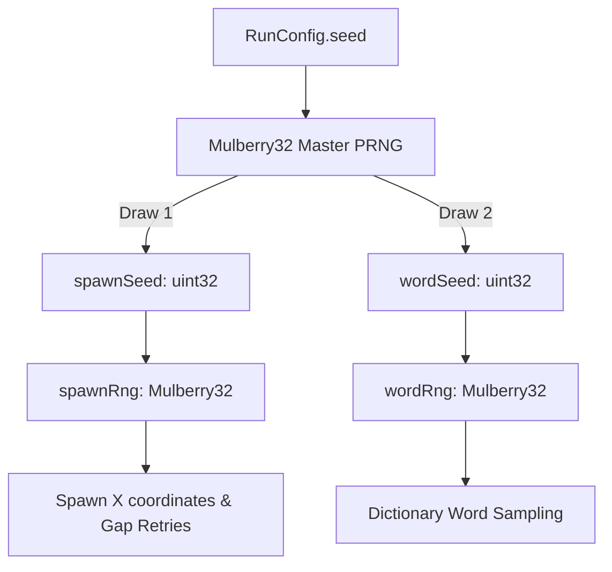

# Caret: The Typing Shooter — Deterministic Game Simulation Architecture

## 1. Overview & Architectural Boundaries
The simulation engine (`src/game/core/simulation.ts`) is a framework-independent, headless, deterministic state machine. It contains zero dependencies on Phaser, React, DOM APIs, or browser globals (`window`, `document`, `Math.random()`, `Date.now()`, `performance.now()`).

All time progression is quantized into discrete 60Hz simulation ticks (`tickRate = 60`), and all random operations are driven by a deterministic Mulberry32 PRNG.

---

## 2. Typing & Combat Rules

### Command Lifecycle
- Game commands (`GameCommand`) are dispatched synchronously to the simulation.
- Commands are strictly ignored unless the simulation status is `'running'`.
- After `'game-over'`, all input commands and `tick()` calls are ignored.

### Target Acquisition & Locking
1. **Unacquired State (No Active Lock):**
   - When a character is typed, the simulation filters all alive enemies on screen whose `remainingWord[0]` matches the typed character.
   - **Tie-Breaking:** If multiple enemies match, the target is chosen by:
     1. Smallest squared Euclidean distance to the player (`distSq`).
     2. Lowest numeric entity ID (e.g. `e1` before `e2`).
   - The selected enemy becomes locked (`activeTargetId = enemy.id`), emitting `TARGET_LOCKED` before processing damage.
2. **Locked State:**
   - Keystrokes are tested exclusively against `lockedEnemy.remainingWord[0]`.
   - If the keystroke matches: damage is dealt, word advances, and the lock persists.
   - If the keystroke mismatches: mismatch penalties apply, but the **target lock stays locked**.
3. **Target Release (`release-target`):**
   - Dispatches a command to intentionally drop the active lock.
   - Emits `TARGET_LOST`, sets `activeTargetId = null`, and leaves partial typing progress intact.
   - Incurs no penalty to score, streak, or accuracy.

### Health, Damage & Destruction
- **Enemy Health:** At spawn, `maxHealth = word.length` and `health = word.length`.
- **Damage per Char:** Each correct keystroke inflicts exactly 1 damage and slices 1 character from `remainingWord`.
- **Destruction:** When `health <= 0` (or `remainingWord.length === 0`), the enemy is destroyed.
- **Score Awarded:** The clear bonus (`enemyClearBonus * multiplier`) is awarded upon word completion and recorded in `ENEMY_DESTROYED.scoreAwarded`.

### Scoring & Metrics Formulas
- **Keystroke Score:** `scorePerChar (10) * multiplier`.
- **Word Clear Bonus:** `enemyClearBonus (100) * multiplier`.
- **Streak & Multipliers:**
  - Monotonic thresholds: Streak 0–4: 1x, Streak 5–9: 2x, Streak 10–19: 3x, Streak 20+: 4x.
  - Reset to 0 on any mismatch (`multiplier` resets to 1x).
- **Accuracy:**
  $$\text{Accuracy} = \begin{cases} 100\% & \text{if } \text{hits} + \text{misses} = 0 \\ \text{round}\left(\frac{\text{hits}}{\text{hits} + \text{misses}} \times 100\right) & \text{otherwise} \end{cases}$$
- **Gross Words Per Minute (WPM):**
  $$\text{WPM} = \begin{cases} 0 & \text{if } \text{elapsedTicks} = 0 \\ \text{round}\left(\frac{\text{hits} / 5}{\text{elapsedTicks} / (60 \times 60)}\right) & \text{otherwise} \end{cases}$$
- **Rating Thresholds:**
  Evaluated at run completion against final accuracy:
  - **S Tier:** $\ge 97\%$
  - **A Tier:** $\ge 92\%$
  - **B Tier:** $\ge 85\%$
  - **C Tier:** $\ge 75\%$
  - **D Tier:** $< 75\%$

### Hull Collisions
- Collision threshold: $\text{distance}^2 \le (\text{enemy.hitboxRadius} + \text{hullRadius})^2$.
- Inflicts `collisionDamage` (20 HP) to player vessel.
- Destroys the colliding enemy with `cause: 'collision'` and `scoreAwarded: 0`.
- If the colliding enemy was the locked target, active lock is cleared with `TARGET_LOST`.
- Collisions do not touch keystroke streak or accuracy metrics.
- If player hull reaches 0, the game immediately transitions to `'game-over'`.

---

## 3. Complete Event Order Specification Table

| Scenario | Event Dispatch Sequence | Notes |
| :--- | :--- | :--- |
| **First char matches unacquired enemy** | 1. `TARGET_LOCKED`<br>2. `INPUT_MATCH`<br>3. `PROJECTILE_SPAWNED`<br>4. `ENEMY_HIT` | Fresh target lock acquired; bolt fired to enemy coordinate. |
| **Middle char matches locked enemy** | 1. `INPUT_MATCH`<br>2. `PROJECTILE_SPAWNED`<br>3. `ENEMY_HIT` | Target already locked; no duplicate `TARGET_LOCKED`. |
| **Final char completing enemy word** | 1. `INPUT_MATCH`<br>2. `PROJECTILE_SPAWNED`<br>3. `ENEMY_HIT`<br>4. `ENEMY_DESTROYED` (`cause: 'word'`)<br>5. `TARGET_LOST` | Entity removed from active snapshot; death effect triggered at kill position. |
| **Typing mismatch (unlocked)** | 1. `INPUT_MISMATCH` (`activeTargetId: null`) | Streak reset, misses incremented. |
| **Typing mismatch (locked)** | 1. `INPUT_MISMATCH` (`activeTargetId: lockedId`) | Streak reset, misses incremented; lock persists. |
| **Release target command** | 1. `TARGET_LOST` | Lock dropped; progress saved on enemy. |
| **Enemy hull collision (survived)** | 1. `PLAYER_DAMAGED`<br>2. `ENEMY_DESTROYED` (`cause: 'collision'`)<br>3. `TARGET_LOST` (if locked) | Hull takes 20 damage, enemy destroyed with 0 pts. |
| **Enemy hull collision (lethal)** | 1. `PLAYER_DAMAGED`<br>2. `ENEMY_DESTROYED` (`cause: 'collision'`)<br>3. `TARGET_LOST` (if locked)<br>4. `GAME_OVER` (`outcome: 'defeat'`) | Status set to `'game-over'`; simulation halts. |
| **Wave start** | 1. `WAVE_STARTED` (`waveNumber`, `quota`) | Dispatched upon run start and after intermissions. |
| **Enemy spawn** | 1. `ENEMY_SPAWNED` (`enemyId`, `position`) | Dispatched on every physical enemy creation. |
| **Wave clear** | 1. `WAVE_COMPLETED` (`waveNumber`, `bonusScore`) | Triggered when quota spawned and all enemies destroyed. |

---

## 4. Discrete Time Model & Timestep Stepper

```mermaid
flowchart LR
    FrameDelta[Variable Frame Delta] --> Stepper[FixedStepper]
    Stepper -->|Clamp <= 0.25s| Accumulator[Time Accumulator]
    Accumulator -->|Every 1/60s (max 5)| SimTick[Simulation.tick]
    Accumulator -->|Leftover fraction| Alpha[Render Interpolation Alpha]
```

- **Tick Rate:** 60 ticks per second (16.666 ms per tick).
- **Fixed Timestep (`FixedStepper`):**
  - Pure mathematical accumulator; clamps input frame deltas to 0.25s maximum (mitigating background tab lag spikes).
  - Executes at most 5 `sim.tick()` invocations per frame to prevent spiral of death.
  - Returns `alpha \in [0, 1)` representing the leftover unsimulated time fraction, used by the visual renderer for smooth entity position interpolation.
- **Velocity Integration:**
  - Direction vector is normalized once upon enemy spawn:
    $$\vec{v} = \frac{\vec{P}_{\text{player}} - \vec{P}_{\text{spawn}}}{\|\vec{P}_{\text{player}} - \vec{P}_{\text{spawn}}\|} \times \left(\frac{\text{speed}}{\text{tickRate}}\right)$$
  - Position is integrated per tick: $\vec{P}_{t+1} = \vec{P}_t + \vec{v}$.

---

## 5. Dual PRNG Stream Architecture

To guarantee that vocabulary modifications never alter wave geometry or enemy spawn sequences, two independent Mulberry32 PRNG streams are derived from `RunConfig.seed`:



### Deterministic Draw Order
1. `masterSeed` initializes the master Mulberry32 generator.
2. **First Draw:** `spawnSeed = Math.floor(master.next() * 4294967296) >>> 0` initializes `spawnRng`.
3. **Second Draw:** `wordSeed = Math.floor(master.next() * 4294967296) >>> 0` initializes `wordRng`.

### Operational Separation
- `spawnRng` is used **exclusively** for horizontal spawn positioning (`intBetween(spawnMarginX, width - spawnMarginX)`) and horizontal gap window retries (up to 5 draws).
- `wordRng` is used **exclusively** by `IWordProvider` to sample candidate words matching the wave's length tier and exclusion rules.
- **Decoupling Guarantee:** Adding, deleting, or reordering words in the dictionary JSON files has zero effect on the spawn locations, spawn intervals, or spatial trajectories of enemies.

---

## 6. Phase 2 Deterministic Replay Specification

Because the simulation state transitions are 100% deterministic and driven strictly by fixed ticks, full gameplay replay recording and playback require only:

1. **Initial Run Header:**
   ```json
   {
     "seed": 1337,
     "tickRate": 60,
     "difficulty": "normal",
     "playerStart": { "x": 640, "y": 620 }
   }
   ```
2. **Replay Action Log:**
   An ordered list of commands stamped with the exact simulation tick on which they were received:
   ```json
   [
     { "tick": 42, "command": { "type": "char", "char": "r" } },
     { "tick": 58, "command": { "type": "char", "char": "e" } },
     { "tick": 71, "command": { "type": "char", "char": "c" } },
     { "tick": 89, "command": { "type": "char", "char": "o" } },
     { "tick": 105, "command": { "type": "char", "char": "n" } },
     { "tick": 340, "command": { "type": "release-target" } }
   ]
   ```
Playback reconstructs identical game states, scores, entity positions, and outcomes down to the exact bit by feeding these commands into `sim.handleCommand()` at the designated ticks.
